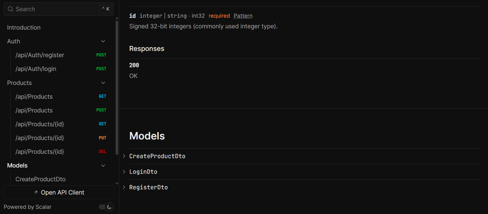

# E-Commerce ASP.NET Core API

[Build Status]
[License]
[.NET Version]

## Short Description

A production-ready, scalable e-commerce backend API built with ASP.NET Core .NET 10, featuring clean architecture, secure authentication, and optimized performance.

## Features

*   **Secure Authentication**: Robust user management with JWT (JSON Web Token) and role-based authorization.
*   **Database Management**: Persistent data access utilizing Entity Framework Core with SQL Server.
*   **Performance Optimization**: Dynamic response caching using In-Memory and Redis for high-traffic scalability.
*   **Professional Logging**: Structured diagnostic tracking via Serilog for easier debugging and monitoring.
*   **Advanced Querying**: Built-in support for API pagination, filtering, and sorting to handle large datasets.

## Installation

1.  **Prerequisites**: Ensure you have .NET 10 SDK and SQL Server installed.

2.  **Clone the repository**: `git clone <your-repo-url>`

3.  **Configure Connection**: Update the `DefaultConnection` string in `appsettings.json` to point to your local SQL Server instance.

4.  **Database Migration**: Run the following commands in the Package Manager Console:
    bash
    Add-Migration InitialCreate
    Update-Database

5.  **Launch**: Run the project using `dotnet run` or via Visual Studio.

## Usage

*   **Swagger UI**: Access the interactive documentation at `/swagger` after starting the application.
*   **Authentication**: Obtain a JWT by calling the `/api/auth/login` endpoint with valid credentials.
*   **Authorization**: Include your token in the request header to access protected endpoints like `/api/products` (POST/PUT/DELETE).

To ensure your `README.md` file reflects the complete development journey from the *ASP.NET Core .NET 10* course, you can incorporate the following **Completed Tasks** section. This provides clear documentation of the technical milestones achieved throughout the project build:

## Tasks Completed

*   **Environment Setup**: Configured the .NET 10 SDK and SQL Server prerequisites for a production-ready environment.
*   **Database Infrastructure**: Implemented **Entity Framework Core** with SQL Server, including full database migration management and data seeding.
*   **Core API Development**: Built a professional **RESTful API** with full CRUD capabilities (Create, Read, Update, Delete) and support for advanced data querying (pagination, filtering, and sorting).
*   **Security Implementation**: Integrated **JWT (JSON Web Token)** for secure user authentication and established granular **role-based authorization** to protect sensitive API endpoints.
*   **Performance Optimization**: Engineered a two-tier caching strategy using **In-Memory caching** for local data and **Redis** for distributed, high-traffic scalability.
*   **Monitoring and Diagnostics**: Deployed **Serilog** for structured, professional logging and enabled comprehensive **Swagger UI** for interactive API documentation and testing.

## Contributing

We welcome community contributions! Please read our CONTRIBUTING.md to understand our workflow and coding standards before submitting a pull request.

## License

This project is licensed under the MIT License. See the LICENSE file for more details.

-----

*Need help or have questions? Please open an issue in the repository.*